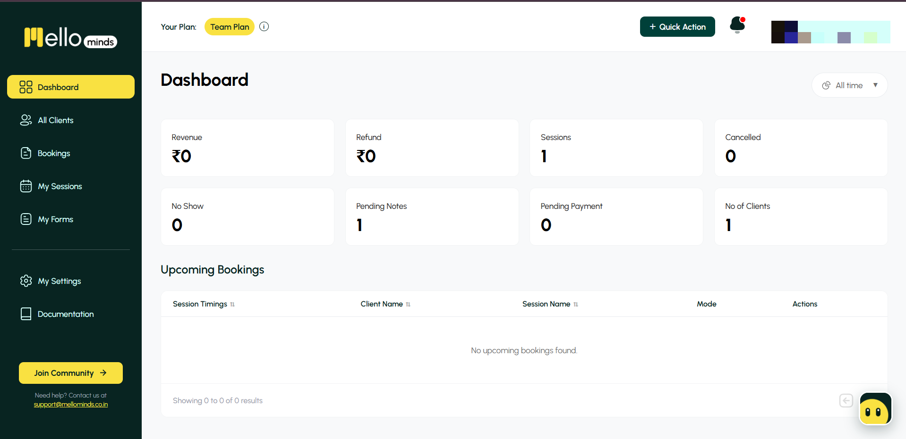

# MelloMinds Sales Lab

An interactive sales-strategy case study for **[MelloMinds](https://mellominds.co.in)**, a practice-management app for therapists, counsellors and clinics in India (bookings, payments, session notes and client records in one place).

**Live demo:** _add your Vercel URL here_ · Built with Next.js, TypeScript and Tailwind CSS



## Why I built this

I built MelloMinds' backend and helped design its deployment and hosting, so I know the product from the inside. I wanted to show I can also *sell* it, not just build it. This project is that attempt: a working sales playbook for one real product, aimed at the outbound, qualification and demo work of a Sales Management Associate.

## The sales problem

MelloMinds has a **Free plan with no credit card**, with paid plans at ₹699 (Individual) and ₹899 per user (Team) per month. Price isn't the barrier. The hard part is **reaching the right practitioners, getting them into a conversation, and getting them to try it** while they run on WhatsApp, paper diaries and spreadsheets. So the questions are: who do I contact first, what do I say, and how do I run a short demo that ends in a free account?

## Target customer segments

| Segment | Likely pain | Plan fit |
|---|---|---|
| Solo private-practice therapist | Bookings over WhatsApp, lost payment screenshots, notes in a notebook | Free → Individual |
| Small group practice (2–10) | No shared schedule, manual client transfers, no practice-level view | Team |
| Psychiatrist using standard questionnaires | Paper or retyped forms (PHQ-9, GAD-7, DASS-21…) | Individual / Team |
| Online-first counsellor | Creating Meet links and reminders by hand | Free → Individual |

Each segment has buying triggers (for example hiring a second therapist, or moving sessions online), a one-line hook, and a disqualify list.

## How prospecting and the pipeline work

1. **Qualify.** Each prospect gets a 1–5 fit score from a written rubric: a clear trigger, manual current tools, and a decision maker who is the practitioner.
2. **Research.** One specific pain and one trigger per account, plus free-text research notes, before any message is written.
3. **Engage.** A fixed **6-touch, 14-day cadence** across email, LinkedIn and calls (Day 1, 2, 4, 7, 10, 14), ending with a clean break-up email. The first email includes an opt-out line.
4. **Track.** A **9-stage pipeline**: New → Researched → Contacted → Replied → Demo booked → Demo done → Free plan started → Upgraded → Lost. Conversion between stages is calculated live.
5. **Demo.** A 20-minute Zoom structure: 5 minutes of discovery questions, a 12-minute demo using real product screens, objection handling, then one small ask: create a free account together on the call.

## What is interactive

- **Pipeline:** drag deals between stages (or use the stage menu); conversion rates update immediately.
- **Prospect workspace:** filter by segment and write research notes that persist in your browser.
- **Outreach studio:** pick a prospect and a message; the template fills in their details, you can edit it, check the personalisation checklist, see a LinkedIn 300-character counter, and copy it.
- **Demo page:** promo videos with clickable chapters, click-to-enlarge product screenshots, and a value calculator that takes the prospect's own numbers.
- **Content page:** the LinkedIn posts MelloMinds used for lead generation.

There is also a **Why Recruit CRM** page that applies the same method to a recruitment-agency buyer.

## What is fictional and what is real

**Fictional:** all 8 prospects (names, contacts, cities, tools, triggers, fit scores), the sample deals and their stages, and therefore every conversion percentage in the pipeline. No customer data is used, and no result in this project is a claimed outcome.

**Real:** the product facts, features and pricing (from MelloMinds' public docs and app), the app screenshots (personal details blurred), the LinkedIn posts and promo videos, and the Recruit CRM description (from its public homepage).

## What I learned about SaaS sales

- **A free plan changes the job.** The goal of outreach and demos is activation (one booking link set up), not a hard close.
- **Triggers beat features.** A new hire, a move online, or a growing client list tells you *when* to reach out; a feature list doesn't.
- **One researched pain outperforms a pitch.** Messages are built around a single named problem, not a product tour.
- **Discovery makes the demo shorter.** Showing only the screens that answer the prospect's pain keeps a 20-minute call focused.
- **Know your funnel stages before you have data.** Defining where prospects drop off makes it clear what to measure first (reply rate, then meetings booked).
- **Honest framing matters.** Labelling sample data clearly keeps the work credible.

## What I would improve next

- Research **real public accounts** and measure actual reply and demo rates.
- Save data in a **database** with CSV import and export, instead of the browser.
- Schedule the cadence with reminders, and A/B test subject lines.
- Add regional-language templates, and GDPR-aware variants for European buyers.
- Run an accessibility audit and add video captions.

## Run it locally

```bash
npm install
npm run dev   # http://localhost:3000
```

Data is stored in your browser's local storage; there is no backend.
